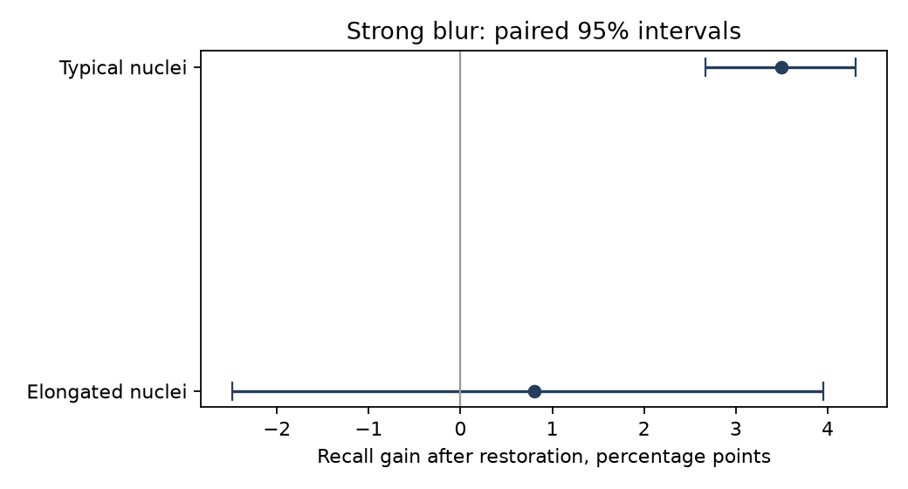
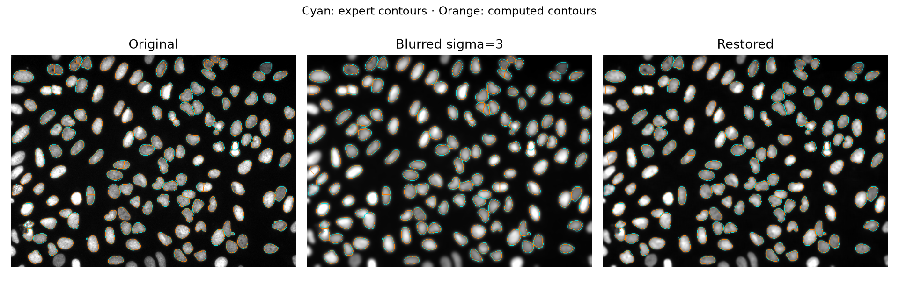

# Nuclear morphology

[](https://github.com/maribrya/nuclear-morphology/actions/workflows/check.yml)
Maria Bryantseva · October 2026 · Unpublished research

Does restoring a blurred microscopy image help detect elongated nuclei as well as typical ones?
BBBC039, 50 test fields, 4,816 complete nuclei; 498 in the elongated group.
Cellpose3 restoration, Otsu/watershed segmentation, expert masks for evaluation.




At sigma=3, typical-nucleus recall rose 82.42% → 85.92%.
The gain for elongated nuclei was inconclusive: +0.80 percentage points,
95% CI −2.49 to 3.96. Shape measurement improved for the common matched subset.

## Run

```sh
pip install -r requirements-summary.txt
python verify_results.py
```

[Run in Colab](https://colab.research.google.com/github/maribrya/nuclear-morphology/blob/main/analysis.ipynb) or open [analysis.ipynb](analysis.ipynb) for plots and a result walkthrough.
For full image processing, install `requirements.txt`, then:

```sh
python download_model.py
python download_data.py
python audit_morphology.py
python run_restoration.py
python summarize_restoration.py
```

Python 3.12; CPU execution. Blur is synthetic; overlap with model pretraining data is not excluded.
Data: [BBBC039](https://bbbc.broadinstitute.org/BBBC039), CC0,
[Caicedo et al., 2019](https://doi.org/10.1002/cyto.a.23863).
Model: [Cellpose3](https://doi.org/10.1038/s41592-025-02595-5);
original CPnet licence in `vendor/cellpose/LICENSE.txt`.
